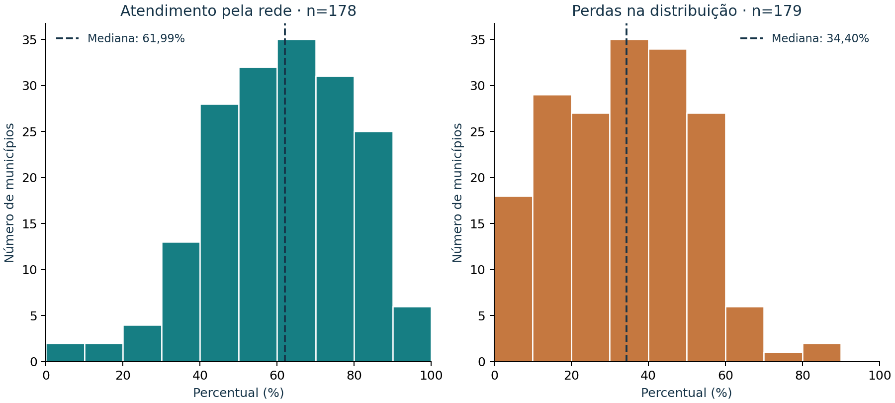
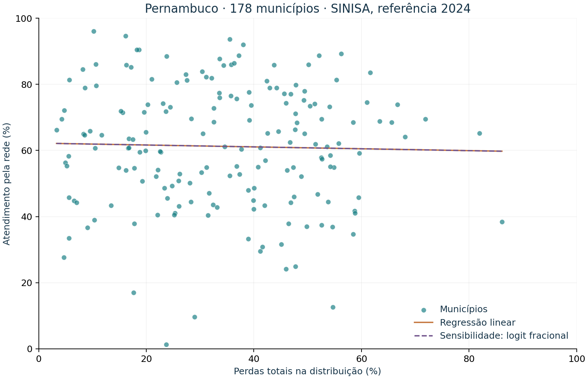

# Água para Todos — Relatório técnico

Versão técnica 1.0. Coleta em 19/10/2026; relatório produzido em 20/10/2026. Fontes brutas preservadas no pacote. Não houve atividade com participantes externos.

## 1. Objetivo e produto

Investigar diferenças municipais no atendimento pela rede de abastecimento e nas perdas de água em Pernambuco, oferecendo uma interface geográfica que torne dados e limitações acessíveis. O produto tem mapa, filtros, comparação, gráficos, fontes e conteúdo educativo. As necessidades do público são hipóteses de descoberta, ainda não verificadas por entrevistas.

Pergunta principal: como se distribuem atendimento e perdas e que associação existe entre eles em 2024? A análise é ecológica e transversal, com município como unidade de observação.

## 2. Fontes e cobertura

- SINISA 2025, referência 2024, base municipal de indicadores e base técnica retificadas em 25/05/2026. Fonte: Ministério das Cidades.
- Censo 2022, SIDRA 6803, variável 381; categorias 72129, 72144, 72145 e 72153. Fonte: IBGE.
- Cadastro e malha simplificada das localidades de Pernambuco, consultados na API oficial do IBGE. A geometria é para visualização, não para análise de tubulações, lotes ou limites de precisão cadastral.

Há 184 municípios e o Distrito Estadual de Fernando de Noronha. A base SINISA contém 179 municípios e o distrito. Cinco municípios estão ausentes: Gameleira, Iati, Inajá, Itambé, Jaqueira. Não se conclui que não tenham serviço. O motivo da ausência não foi confirmado.

Quipapá tem atendimento não calculado na fonte. A soma da população atendida urbana e rural é 25.265, superior ao denominador populacional de 17.974. Essa condição é compatível com o bloqueio previsto na nota metodológica. O valor não foi corrigido ou imputado. Seu indicador de perdas está disponível.

Assim, o modelo utiliza 178 municípios, ou 96,74% do universo municipal. Seis municípios não participam do ajuste conjunto. Fernando de Noronha fica fora da modelagem municipal. A Região Metropolitana tem 14 pares numéricos disponíveis.

O Censo e a malha cobrem as 185 localidades. Os dados censitários são complementares e mantêm referência 2022. Não foram usados para substituir os registros de 2024.

## 3. Tratamento e rastreabilidade

O pipeline lê as planilhas sem alterá-las, reconhece os cabeçalhos por código, filtra PE, exige unicidade por código IBGE e confere correspondência com o cadastro. Foram preservados motivos de não cálculo. Não houve substituição de ausências por zero, médias ou estimativas. Percentuais estão na escala 0–100.

As duas bases municipais SINISA têm 180 registros de PE e integração um para um. Foram recalculados 359 indicadores, incluindo o distrito, todos compatíveis com os valores publicados dentro de 0,011 ponto percentual. A soma das três categorias censitárias de primeiro nível confere com o total para 185 localidades. Nenhum valor numérico dos quatro indicadores SINISA selecionados ficou fora de 0–100.

As checagens atestam consistência interna, não a exatidão das declarações. URLs, datas e hashes SHA-256 estão em `data/processed/sources.json`. O dicionário define as variáveis e fórmulas.

## 4. Análise exploratória

| Indicador (%) | n | Média | Mediana | Desvio-padrão | Q1 | Q3 | Mínimo | Máximo |
|---|---:|---:|---:|---:|---:|---:|---:|---:|
| Atendimento | 178 | 61,24 | 61,99 | 18,47 | 47,29 | 75,03 | 1,37 | 96,08 |
| Perdas | 179 | 34,15 | 34,40 | 17,54 | 19,73 | 47,69 | 3,31 | 86,11 |

Cada indicador usa seus próprios casos disponíveis. As médias e medianas acima resumem municípios com o mesmo peso; não são taxas agregadas estaduais nem estimativas populacionais ponderadas. As estatísticas variam conforme o recorte e a seleção de casos.

Valores extremos pelo critério de 1,5 amplitude interquartil foram sinalizados para inspeção, sem exclusão automática. Percentual baixo ou alto não implica erro por si só. Sistemas compartilhados e características socioeconômicas não foram controlados.

## 5. Modelagem e inferência

H0: ausência de associação monotônica entre perdas e atendimento no processo de referência considerado. H1: associação diferente de zero. O coeficiente de Spearman é descritivo para o conjunto observado. Seu teste por permutação pressupõe permutabilidade sob H0, que pode ser afetada pela dependência espacial.

O modelo linear candidato é Atendimento = β0 + β1 × Perdas + erro. Foram incluídos intercepto e um único preditor, sem variáveis de períodos diferentes. É uma aproximação descritiva, não um mecanismo causal. A resposta é limitada e, por isso, ajustou-se um modelo fracional logit como sensibilidade. Nenhum percentual foi transformado em contagem artificial.

| Resultado | Valor |
|---|---:|
| Casos completos | 178 |
| Spearman ρ | -0,022690 |
| Valor-p nominal por 9.999 permutações | 0,761 |
| Intercepto OLS | 62,207288 |
| Inclinação OLS, p.p. por p.p. | -0,028315 |
| IC 95% nominal da inclinação, HC3 | [-0,176663; 0,120033] |
| Valor-p nominal OLS/HC3 | 0,706857 |
| R² | 0,000723 |

A associação monotônica é muito fraca. O modelo linear descreve uma fração muito pequena da variabilidade observada. O intervalo nominal da inclinação inclui zero. Isso não prova independência em geral nem demonstra ausência de relação em outras escalas ou períodos.

HC3 fornece covariância robusta a heterocedasticidade; utilizou-se referência t com os graus de liberdade residuais. Essa correção não resolve dependência espacial nem sistemas comuns de abastecimento. Como os municípios constituem um universo territorial e não uma amostra aleatória, a inferência é condicional a um modelo de processo hipotético e não uma margem de erro amostral de Pernambuco. Não se formula conclusão confirmatória.

## 6. Diagnósticos e sensibilidade

- Moran I dos resíduos: 0,178256, valor-p por 999 permutações: 0,001. Há sinal de dependência espacial sob a vizinhança adotada.
- Vizinhança: cinco vizinhos mais próximos, simetrizada e padronizada por linha. Distância aproximada em quilômetros com latitude média, a partir do centro da caixa do maior anel geográfico por número de vértices. É diagnóstico exploratório; outras malhas e vizinhanças podem mudar o resultado. Não é modelo espacial ajustado.
- Teste de Breusch–Pagan nominal: p = 0,588721. Seu resultado não elimina outros problemas do modelo.
- Retirando um município por vez, a inclinação varia de -0,047440 a -0,006800.
- Cook acima de 4/n: Caetés, Calçado, Carnaubeira da Penha, Cortês, Jupi, Paranatama, Salgadinho, Santa Cruz da Baixa Verde. São sinais de influência para investigação, não motivos automáticos de exclusão.
- Ajustes lineares fora de 0–100% no domínio observado: 0. Não extrapolar para outros valores ou períodos.
- Modelo fracional logit convergiu; coeficiente de perdas na escala logit: -0,001193. Os ajustes observados vão de 59,76% a 62,11%. O coeficiente logit não deve ser lido como pontos percentuais.
- RMSE no ajuste: 18,410 p.p. RMSE deixe-um-fora: 18,607 p.p. Referência pela média dos demais municípios: 18,520 p.p. O modelo não melhora a referência nessa verificação. A validação não separa regiões e pode ser otimista sob dependência espacial.

Decisão: disponibilizar a análise como investigação exploratória, com diagnósticos. Não oferecer previsão operacional nem recomendações automáticas de investimento. O resultado fraco é um achado válido; não se troca a hipótese apenas para obter significância.

## 7. Produto, testes e reprodução

O site estático utiliza Preact, Vite, Leaflet e Plotly.js; o pipeline utiliza Python, NumPy, SciPy, Statsmodels e openpyxl. O processamento é anterior ao build. As bibliotecas do mapa e dos gráficos são locais, sem dependência de CDN para o uso.

Passaram 23 testes Python e 14 testes JavaScript/componentes. A integração do mapa foi exercitada em DOM simulado. O build de produção foi concluído. Não foi feita inspeção visual em navegador real, teste móvel real, execução em Windows ou publicação no GitHub Pages. Os limites e o roteiro local estão em `docs/verificacao.md` e `docs/roteiro_teste_usuario.md`.

Reprocessamento: `python -m agua.pipeline`. Relatório: `python scripts/gerar_relatorio.py`. Testes: `python -m pytest -q` e, em `web`, `npm test`. Site: `npm run build`; depois `python iniciar_site.py` a partir da raiz.

## 8. Extensão, Direitos Humanos e Educação Ambiental

Estão preparados roteiro e questionários para uma oficina sobre interpretação dos dados, acesso à informação e consumo responsável. Não houve participantes externos ou atividade executada. A avaliação pela responsável pelo projeto não é substituída por relatos fictícios de extensão.

A aplicação discute desigualdades de atendimento e limitações de indicadores agregados. Evita responsabilizar exclusivamente moradores por problemas estruturais, distingue perdas de desperdício doméstico e não publica dados pessoais.

## 9. Limitações e dados faltantes

Cinco municípios sem registro SINISA, um atendimento não calculado e possível viés de seleção dos casos completos. Não há dados de qualidade da água, rede física, vazamentos localizados, continuidade ao vivo, renda ou série histórica harmonizada. O Censo 2022 é contextual, não diretamente comparável ao atendimento populacional SINISA. O indicador municipal não descreve todos os bairros ou domicílios.

A malha é simplificada e consultada na data da coleta; não houve auditoria histórica de limites. O prestador apresentado é o registrado na fonte de 2024, sem imputar os resultados a uma concessionária atual. Não há índice composto de vulnerabilidade nem comprovação de impacto social nesta entrega.

## 10. Referências verificáveis

1. Ministério das Cidades. Resultados SINISA 2025, referência 2024. https://www.gov.br/cidades/pt-br/acesso-a-informacao/acoes-e-programas/saneamento/sinisa/resultados-sinisa/resultados-sinisa-2025
2. IBGE. Censo Demográfico 2022, SIDRA, tabela 6803. https://sidra.ibge.gov.br/tabela/6803
3. IBGE. API de malhas geográficas, versão 3. https://servicodados.ibge.gov.br/api/docs/malhas?versao=3
4. Statsmodels. OLS e covariância HC3. https://www.statsmodels.org/stable/generated/statsmodels.regression.linear_model.OLS.html e https://www.statsmodels.org/stable/generated/statsmodels.regression.linear_model.OLSResults.HC3_se.html
5. SciPy. Spearman rank-order correlation. https://docs.scipy.org/doc/scipy/reference/generated/scipy.stats.spearmanr.html
6. ANA. Cursos e capacitação. https://www.gov.br/ana/pt-br/acesso-a-informacao/acoes-e-programas/cursos-e-capacitacao

As fórmulas e regras oficiais usadas estão também nas notas metodológicas das planilhas preservadas. As referências não substituem a inspeção dos dados ou a explicação dos pressupostos.
